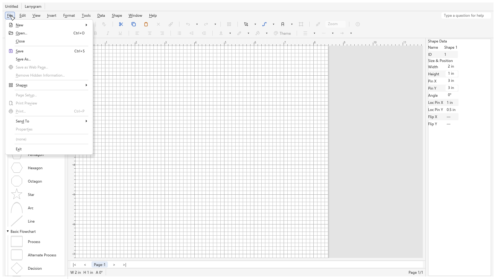
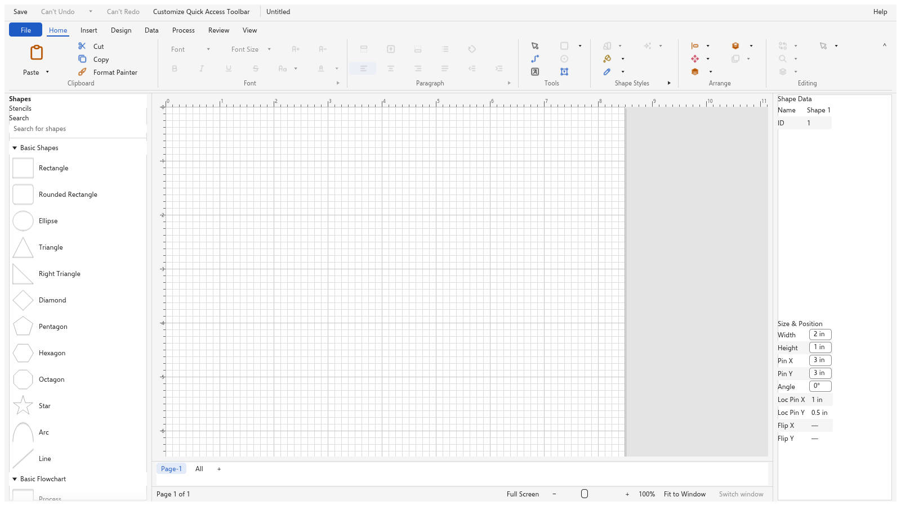
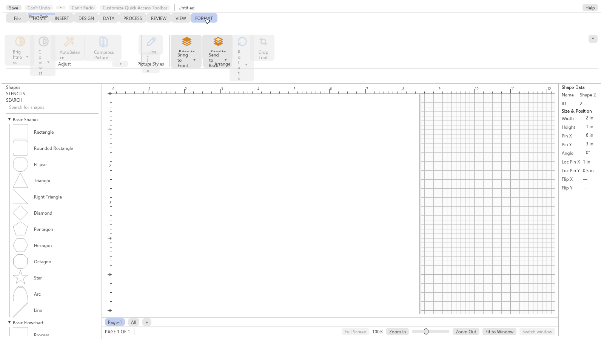
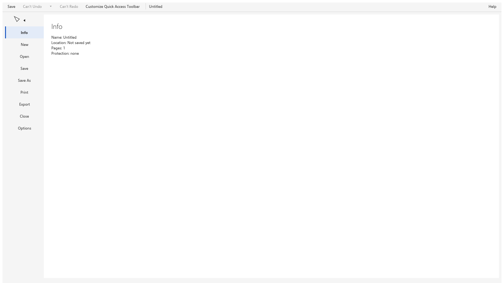
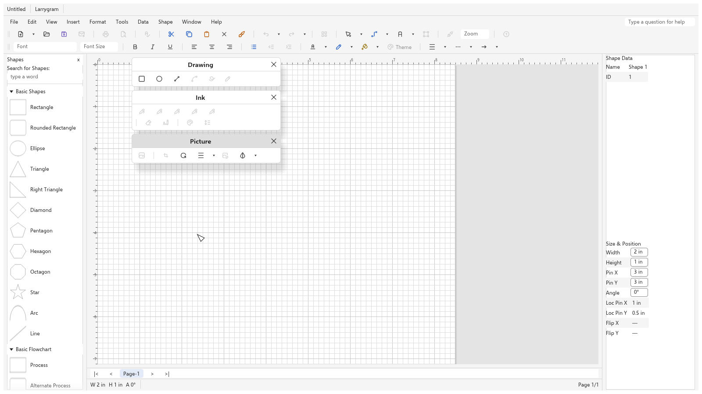

# Phase 7 report: Panel and Classic layouts, the rename, the welcome wizard

Phase 7 gives Larrygram its two flagship window layouts — Panel Modern
(command bar) and Panel Classic (menu bars and toolbars) — as
data-driven surfaces: four layout kinds load from `ui-spec/`, switch at run time,
and every control dispatches its command through the one registry.
The phase also carried the product rename (Larrygram, ADR 0067's brand
art), the welcome wizard and the About window. Started 2026-10-24,
closed 2026-10-25.

## What was built

| Area | Content | Tasks |
|---|---|---|
| Layout format v2 | `ui-spec/layouts/*.yaml` + `layout-v2.schema.json` (ADR 0061): menu bars, toolbars, tabs, groups, controls, context menus, the File view and the QAT, with placement slots (`column`, `row`, `size`). A staged, bounded, panic-free loader and the v1 adapter for the two Fluent-data kinds. | P7-01, P7-03 |
| Rename boundary | The Larrygram rename across the tree (names gate), ADR 0067's brand art and the icon set (Tabler, MIT). | P7-00, P7-01 |
| Panel Classic | Menu bars with ten menus and access keys, icon-gutter menus with submenus, docked and floating toolbars (splits, palettes, combos), context menus, the Shapes window and the classic status bar and page tabs. | P7-06 |
| Panel Modern | Tab strip with the contextual tab sets, the command bar (`stack`/`rows` placement), every control kind, the File view, the QAT and the collapse/overlay rules. | P7-07 |
| Contexts | The ADR 0064 selection contexts, `menu_for`'s hit-target mapping and the predicate cross-check against `contexts.yaml`. | P7-08 |
| Shell wiring | The four-layout frame, the theme and icon seams, the wizard and About windows, the settings, lists and window state. | P7-09 |
| Icons and themes | The Tabler rasteriser with its bounded cache (ADR 0062), the theme-token seam on egui (ADR 0063) with Selawik. | P7-04, P7-05 |
| Wizard and About | The two-page welcome wizard and the About window (ADR 0066, amended at P7-14), the window icon and favicon. | P7-15, P7-16 |
| Tests and audits | The ADR 0065 sweeps (menus, controls, placement, surfaces), seven window goldens before P7-14 (twelve after), the `layout_v2` fuzz target, and the three audits. | P7-10..P7-14 |

## Exit criteria

The eleven Phase 7 exit criteria are covered task by task in the P7-10
Result (a table of criterion to test). After P7-14's fixes the open
gaps are small: the 2016/365 backstage commands are all stubs, so the
"a backstage command leaves the File view" rule is pinned as a unit
test over `leaves_file_view` rather than a click; and the six
context-menu targets that need window state (full-screen view, master
editing, embedded objects) are marked pending in
`docs/ui/panel-classic.md`.

## The audits, and what P7-14 did about them

`docs/reviews/phase-7-review.md` (P7-11, approve with fixes),
`docs/reviews/phase-7-coverage.md` (P7-12, 10 major + 10 minor) and
`docs/reviews/phase-7-cleanroom.md` (P7-13, pass, 2 minor fixed by the
master).

| Finding | Fix | Commit |
|---|---|---|
| P7-11 F1 (major): most theme tokens were dead data; the widgets drew from egui defaults and hard-coded metrics | `theme::color_at` is the widget seam; a `ClassicMetrics` reader takes every Panel Classic size from the theme; menu highlight and open menu bar, separators, gutters, panes, status bars, tabs, page tabs, groups, the File view and the contextual tab sets read their tokens; both themes carry the full vocabulary; `scroll.track` and `icon.large` deleted (no surface draws them); new test `every_theme_token_is_read_by_a_widget` | `1290a90` |
| P7-11 F2 (major): the disabled-icon rule (40% alpha) was wired to nothing | the menu, toolbar and command-bar callers pass the enabled state; one disabled icon rendered in both states and asserted at the 40% blend | `300fad2` |
| P7-11 F3: stale "until P7-05" comments | rewritten to name the seam that exists | `1290a90` |
| P7-11 F4: ADR 0066 said Cancel keeps Panel Modern | the ADR now says "keeps the current layout (Panel Modern on a first launch, where it is the default)" | `9c614a1` |
| P7-11 F5: the guide's context-menu table read as current behaviour | the table marks every target routed or pending, with what is missing | `f5db186` |
| P7-11 F6: the welcome-wizard Options row was the one action outside the command registry | the row dispatches `help.welcome.next_start` with its `show` argument; the builtin sets `welcome_seen`; no undo, like the other rows | `e97da91` |
| P7-12 major 1: the Help menu never opened in a test | one kittest click through the menu dispatches its entry | `dc2955e` |
| P7-12 major 2: the real file picker never ran | the dialog wiring is a pure `DialogSpec` with tests over title, filter and suggested path | `273fb9a` |
| P7-12 major 3: no test provoked a shell error | a failing command's error reaches the status line in every layout (it used to reach only the Phase 4 status bar) and the frames keep rendering | `16da2a9` |
| P7-12 major 4: the toolbar popups' nested submenus closed when the pointer moved into them | the popups walk a `popup_chain` with the submenu delay (the `context_chain` rule, now shared) | `c6c799c` |
| P7-12 major 5: the Panel Modern dispatch arguments were unasserted and carried no `value` | choice rows attach the `value` argument and inherit the opener's command; the popup sweep asserts the args; a unit test drives a dropdown's choice | `06da902` |
| P7-12 major 6: the page-tabs "All" menu was never opened | opening it and clicking a row pins the list and the page switch | `dc2955e` |
| P7-12 major 7: the 2016/365 backstage was untested | the page rows switch pages under the Phase 4 rig; the leave rule is `leaves_file_view` with its unit test | `10e898e` |
| P7-12 major 8: six context-menu targets could never be routed | the pane, page-tab and navigation right-clicks route (four targets more than before); the rest are pending in the guide until their window state lands | `6391a49` |
| P7-12 major 9: the sweep oracle mirrored the widget rules | the File, Edit and View menus match a hand-written fixture of their 57 rows | `d5a6936` |
| P7-12 major 10: the rendered placement geometry was half asserted | the labels stop wrapping one letter per line (the atoms' measured widths) and `every_drawn_control_fits_its_label` asserts the fit | `e04cb22` |
| P7-12 minors 1, 2, 6 | the layout-radio arms and the test edit halves get their tests; the Watch Video arm says why it stays dark | `73a2990` |
| P7-12 minor 7 | the goldens regenerate with the fixes above (and the picture-tools band sits above its tab) | `e04cb22`, `3939404` |
| P7-12 minor 8 | the floating toolbars open below the docked rows, cascaded, and a golden renders them at the defaults | `07c1abc` |
| master note: the open File menu's labels were nearly invisible | the menu labels take `chrome.text` / `chrome.text_disabled` from the theme | `1290a90` |
| master note: several menu icons drew as solid dark squares | the disabled-icon fix above (the squares were the placeholder fill) | `300fad2` |
| master note: the QAT customise menu was unreachable | a display-only menu opener draws enabled whatever its command says | `7217305` |

Not fixed, recorded: the failed master preview (P7-12 minor 3), the
context-menu edge arms (minor 4) and the wizard's defensive layout
fallback (minor 5) stayed as they were (small, defensive, and the
branches need fixtures the widget seams do not expose). The ratchet
table in `coverage.toml` is the master's (minor 9). The contextual set
caption overlaps its tab label in the 25 px strip (cosmetic, seen in
the picture-tools golden).

## The window goldens

Rendered by Larrygram itself (the `egui_kittest` wgpu renderer, ADR
0065), regenerated with `LARRYGRAM_UPDATE_GOLDEN=1 cargo test -p
larrygram-ui --test phase7 golden`. The ADR 0027 metric compares them
(per-channel delta 2, 0.5% of the pixels may exceed it).

Panel Classic with the File menu open:

Panel Modern on the Home tab:

Panel Modern with the Picture Tools contextual tab set:

The Panel Modern File view:

Panel Classic with the floating toolbars at their shipped defaults:

The brand-art goldens (not MIT: they render ADR 0067's artwork; a fork
must replace or regenerate them) are linked, not shown:
[`wizard-welcome`](../../crates/ui/tests/phase7/golden/wizard-welcome.png),
[`wizard-layout`](../../crates/ui/tests/phase7/golden/wizard-layout.png)
and [`about`](../../crates/ui/tests/phase7/golden/about.png).

## Cross-checks and their differences

The data cross-checks run in the test suites (`ui-spec/tests/loader.rs`
and `tests/phase7/`): every `command` in the layouts resolves in
`commands.yaml` (the `new_command` valve aside), every `icon` key
resolves in `ui-spec/icons.yaml`, every `shown_in` names a
`contexts.yaml` row, placement ids are unique per surface, every theme
token the widgets read exists in both themes and now every theme token
is read by a widget. The differences they leave standing:

- **`context.page_tab_navigation` has no menu in the Panel Classic
  data** while the Panel Modern data has one and the shell routes the
  target (pinned by
  `shell::tests::the_classic_strip_records_its_navigation_buttons`).
  A data gap for the layouts' owner.
- **The contexts allowlist** (`tests/contexts/crosscheck.rs`): the
  Larrygram-only and Phase 5/7 command ids have no 2007
  `contexts.yaml` row and are listed with their reason;
  `help.welcome.next_start` joined them (a settings flag).
- **Six hit targets are pending** (the guide table): they need window
  state that does not exist yet (full-screen view, master editing,
  embedded objects) or one more widget's hit rects.
- **The v1 adapter's known limits** (P7-03, snapshot-pinned): the
  2016/365 File view pages and the unmapped contextual tab sets.

## Gate results

<!-- Filled at hand-off (the gate queue's result). -->
